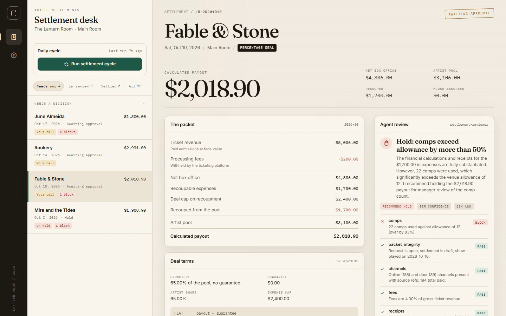

# Loadout

A settlement desk for an independent music venue.

Every show ends with the same pile: two ticket exports, a folder of receipts, a deal that was negotiated in an email, and an artist waiting to be paid. Loadout turns that pile into one reviewable packet, has an agent audit it, and leaves the transfer behind a human decision.

This is a complete Lemma pod. The tables, the app, the agent, the functions, and both workflows install together.



[Watch the two-minute demo](docs/loadout-demo.mp4). It shows a live review, a hold, an approval, and a payment close.

## The problem

A 420-cap room runs on trust and a spreadsheet. The booker knows the deal. The bar manager knows the comps. The ticketing platform knows the fees. Nobody has one number that reconciles all three, so settlement night becomes a text thread:

- Was the guarantee $1,200 or $1,250?
- Did the $1,800 backline rental come out of the artist pool or the house?
- The online export says 152 paid. The door sheet says 23. Which one is right?
- Did we already pay this show?

The expensive mistakes are quiet ones. A missing receipt gets recouped anyway. A percentage deal gets rounded in the artist's favor twice. A show gets paid twice because the second reviewer did not see the first transfer. Nothing looks broken until the artist calls.

## What Loadout does

- Watches for shows that have played and have no settlement.
- Reconciles every ticket channel, subtracts processor fees, applies the deal's recoup cap, and snapshots the result in integer cents.
- Opens one review request per new packet, which starts the audit workflow.
- Builds one fixed evidence packet per review, then has `settlement-reviewer` check ten things and return numbered findings with a recommendation. The reviewer is toolless: it sees the packet and nothing else, so it cannot wander into the datastore or change a number.
- Puts the payout behind a form assigned to the desk approver. Approve, approve a different amount with a written reason, or hold.
- Waits for a transfer reference before closing the settlement. A held packet can be reopened; a paid one cannot.

## A normal week

The room closes on Saturday. Sunday morning the cycle runs at 09:00, finds the played show, and builds the packet. The reviewer notices a missing receipt on a $1,800 backline invoice and recommends a hold. The manager opens the desk, reads the finding, and holds the payout with one line of context.

The invoice arrives Tuesday. The manager reopens the settlement with the reason "Clearwater invoice received." A fresh review request opens, the agent reruns the checks against the same stored arithmetic, and this time the packet is clear. The manager approves $1,908.90. Wednesday the transfer clears; the manager records the bank reference and the settlement closes.

Every step is on the activity trail: who prepared it, which checks ran, what the agent found, who approved it, and which transfer closed it.

## The chain of custody

The design keeps three kinds of work separate:

| Layer | Owns | Cannot do |
|---|---|---|
| `prepare_settlements` | The arithmetic. One formula, integer cents, cap snapshot. | Change its mind later. |
| `build_review_packet` | The evidence. Reads the seven source tables and adds a fresh recomputation of the deal. | Decide, or write anything. |
| `settlement-reviewer` | Judgment about completeness and policy. | Use tools, move money, edit the settlement, approve. |
| The approval form | The decision. A person, a name, a note. | Skip the audit or pay without a reference. |

The calculated payout is stored before the agent sees the packet. The packet carries a fresh recomputation from the raw rows, and the reviewer reports a block if the stored value differs. A manager can approve a different amount, but only with a note; the original calculation stays on the row for comparison.

`mark_paid` refuses anything that is not `approved`. `reopen_settlement` refuses anything that is `paid`. Neither rule depends on the agent behaving well.

## The money

All amounts are integer cents. The formula is in `tools/settlement_math.py` and in `prepare_settlements`:

```text
ticket_revenue  = sum(paid_quantity * face_value_cents) per channel
net_box_office  = ticket_revenue - sum(fees_cents)
recoupable      = sum(amount_cents where recoupable)
recouped        = min(recoupable, expense_cap_cents)
over_cap        = recoupable - recouped
pool            = max(0, net_box_office - recouped)

FLAT            payout = guarantee
PERCENTAGE      payout = round_half_up(pool * percentage_bps / 10000)
VS              payout = max(guarantee, round_half_up(pool * percentage_bps / 10000))
```

`round_half_up` is `(amount * bps + 5000) // 10000`. Comps are tracked and checked against an allowance, but they are not deducted from revenue: a comp is a seat given away, not a sale that was refunded.

The recoup cap is copied onto the settlement at preparation time. Editing the show's deal later cannot change a payout that was already reviewed.

## The ten checks

The reviewer runs every check and uses these ids in its findings. Any block means a hold. Two or more watches also mean a hold.

| Check | What it verifies |
|---|---|
| `packet_integrity` | Request, settlement, and show agree; show is played; settlement is a draft; date is not in the future. |
| `channels` | Online and door rows both exist with source references and non-negative counts. |
| `fees` | Processor fees as a share of gross. Up to 5.00% passes, up to 8.00% watches, above that blocks. |
| `receipts` | Every recoupable expense at or above the receipt threshold has a reference. |
| `recoup_cap` | Recoupable total against the cap; overage is reported and house-absorbed. |
| `comps` | Total comps against the allowance. Up to 50% over watches, more blocks. |
| `deal_math` | Recompute every stored money field; confirm the winning side of a VS deal. |
| `payout_floor` | The payout is at least the guarantee on FLAT and VS, and positive on a played show. |
| `prior_payment` | No other paid settlement points at the same show. |
| `reopen_context` | If the packet was reopened, quote the reason and check whether it is resolved. |

The written rules live in `files/policy/` for the people who maintain the desk. The reviewer gets the same rule set in its instruction and cannot read outside the packet; when a source is missing it names the field and blocks instead of guessing.

## What is in the repository

```text
loadout/
  pod.json                       bundle identity
  apps/settlement-desk/          the queue, packet, review, approval form, and payment close
  tables/                        seven tables with one month of seeded shows and history
  agents/settlement-reviewer/    the packet-only audit instructions
  functions/                     prepare, build packet, attach review, record decision, pay, reopen
  workflows/settlement-cycle/    the daily function call
  workflows/settlement-approval/ event-driven audit and human gate
  schedules/                     daily 09:00 cycle and review_requests INSERT trigger
  files/policy/                  settlement policy, deal guide, close checklist
  tools/                         seed generator, shared math, bundle verifier
  tests/                         math, seed, workflow, and bundle invariants
```

| Table | Holds |
|---|---|
| `shows` | The booking, the deal terms, the cap, and whether the show played. |
| `ticket_sales` | One row per channel per show, with fees, comps, and the export reference. |
| `expenses` | Vendor, amount, category, whether it is recoupable, and the receipt reference. |
| `settlements` | The snapshot: every money field, the deal, the agent review, the decision, and the payment. |
| `settlement_events` | Prepared, review ready, approved, held, paid, reopened. Append-only in practice. |
| `review_requests` | The trigger record. Open requests start the approval workflow. |
| `settings` | Venue name, approver, comp allowance, receipt threshold, and the last cycle time. |

`review_requests` exists so the approval workflow can trigger on an INSERT without re-triggering every time a settlement row is updated. It also makes reopening explicit: a new request is a new review, with its own audit trail, rather than a status flip that might be missed.

## The app

The settlement desk is a static Lemma app in `apps/settlement-desk/html.html`. It builds into `dist.zip` when the pod is imported.

- **Queue:** Needs you, In review, Settled, All. Rows group into Needs a decision, In review, Ready to pay, and Settled.
- **Packet:** ticket revenue, fees, net box office, recoupable expense, the cap, the pool, and the calculated payout, next to the deal terms.
- **Review:** the agent's headline, recommendation, confidence, and every finding in block-watch-pass order.
- **Your call:** approve the calculated amount, change it with a required note, or hold. The form is submitted through the workflow's active wait, so the human gate stays in the workflow rather than becoming a direct database write.
- **Payment:** an approved settlement stays in Needs you until a transfer reference is recorded.
- **Activity:** the full event trail for the settlement.

The first time the app loads in a pod with no configured approver, it claims the desk for the signed-in member by writing their pod member id to `settings.approval_member_id`. If the setting is blank, the approval workflow uses an unassigned form instead, so a missing setting can never strand a packet.

## Seeded data

The bundle imports with one month of invented history for The Lantern Room, a fictional 420-cap room. Every name, address, receipt, and reference is fictional.

- Ten shows from September 18 to October 17, 2026.
- Five paid settlements, each with a complete review, a named approver, a payment reference, and an event trail.
- One held settlement: Mira and the Tides, where a $1,800 backline invoice has no receipt, the recoup total is $250 over the cap, and 18 comps exceed the 12-comp allowance.
- Four played shows with no settlement, waiting for the first cycle.
- Deliberate clean packets, one-watch packets, and one blocking packet so the reviewer has something real to find.

The desk is seeded as if it were last active on October 4. The four later shows are the first thing the cycle prepares after import.

## Install

Import the repository into a Lemma workspace:

```text
https://lemma.work/import/github/Senthil455/loadout
```

Or from the command line:

```bash
git clone https://github.com/Senthil455/loadout.git
cd loadout

lemma pods import . --dry-run
lemma pods import .
```

After import:

1. Open the settlement desk app.
2. The app claims the desk for you if no approver is set.
3. Press **Run settlement cycle**. Four packets are prepared and reviewed.
4. Pick Mira and the Tides to see a held packet with a blocking receipt finding.
5. Approve a clean packet, then record a transfer reference to close it.
6. Open a held packet, add the missing receipt reference, and reopen it to watch the review run again.

The daily schedule runs at 09:00 America/New_York. It is active on import, so a pod left alone will prepare the next show the morning after it is marked `played`.

## Settings

| Setting | Default | What it changes |
|---|---|---|
| `venue_name` | The Lantern Room | The name in the app header. |
| `room_name` | Main Room | The default room on a settlement. |
| `approval_member_id` | blank | The pod member who receives approval forms. Blank means any member can answer. |
| `comp_allowance` | 12 | Comps per show before the reviewer raises a watch. |
| `receipt_threshold_cents` | 25000 | Recoupable expenses at or above this need a receipt reference. |
| `currency` | USD | Display currency for the desk. |
| `activated` | true | Whether the desk has been opened for this venue. |
| `last_cycle_at` | seeded | Shown as the last cycle time. |

The receipt threshold and comp allowance are read by the agent at review time. The deal terms and cap come from the show, and are snapshotted onto the settlement.

## Verify the bundle

The repository ships a verifier and tests that do not need a running Lemma stack:

```bash
python tools/verify_bundle.py
python -m pytest tests -q
```

The verifier checks JSON validity, required resources, ASCII-only content, CSV headers against table schemas, foreign keys, seed arithmetic, review check ids, workflow graph references, packet-builder permissions, and that the reviewer carries no toolsets or grants. The tests cover the deal formula, the seed's expected payouts, the packet's derived amounts, and the workflow's node and edge invariants.

Inside a live pod, the equivalent import check is:

```bash
lemma pods import . --dry-run
```

## Design notes

**Why a trigger table instead of triggering on `settlements`.** A settlement is updated many times during its life: review attached, decision recorded, payment recorded. Triggering the audit on every update would rerun it on its own writes. `review_requests` gives the workflow exactly one start per review and leaves the settlement row free to change.

**Why the agent does not calculate the payout.** An agent that both computes and audits the number can hide its own arithmetic mistake. The function computes once, stores the result, and the agent recomputes independently. A mismatch is a block, not a correction.

**Why the approval form is submitted, not called around.** The app submits the waiting workflow form. Calling `record_review` directly from the browser would work technically, but it would leave the workflow waiting and turn a human gate into a database write. The form is the gate.

**Why the cap is copied.** Settlement rows are financial records. A later edit to the booking should not silently rewrite the basis of a payout that a person already approved.

**Why holds are first-class.** A hold is not an error state. It is a decision to wait for a missing receipt or a corrected deal. Keeping the hold, its reason, and the later reopen on the same settlement is what makes the trail useful when someone asks why a payment was late.

## Limits

- Loadout does not move money. It records the decision and the transfer reference; the actual bank or ACH action stays with the venue.
- The seed uses invented data. There is no live ticketing or accounting connector in this bundle; imports are rows in `ticket_sales` and `expenses`.
- The agent needs a configured model in the Lemma workspace. The rest of the pod works without one, but packets stay in `draft` until a review is returned.
- The daily cycle prepares shows marked `played`. Marking a show played is a human or upstream system action, not something the cycle infers from the date alone.

## Repository guide

- [Implementation notes](docs/implementation-notes.md)
- [Demo script](docs/demo-script.md)
- [Contributing](CONTRIBUTING.md)
- [Security](SECURITY.md)
- [License](LICENSE)

## License

MIT. See [LICENSE](LICENSE).
